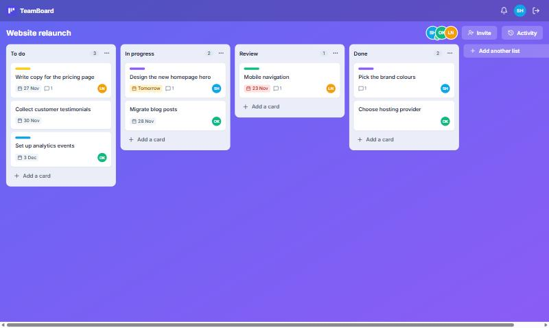
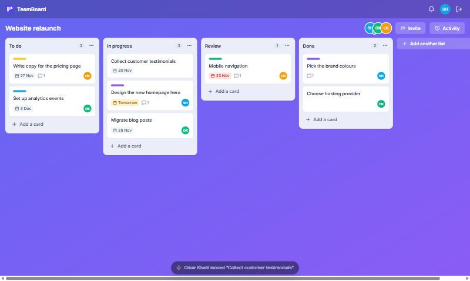
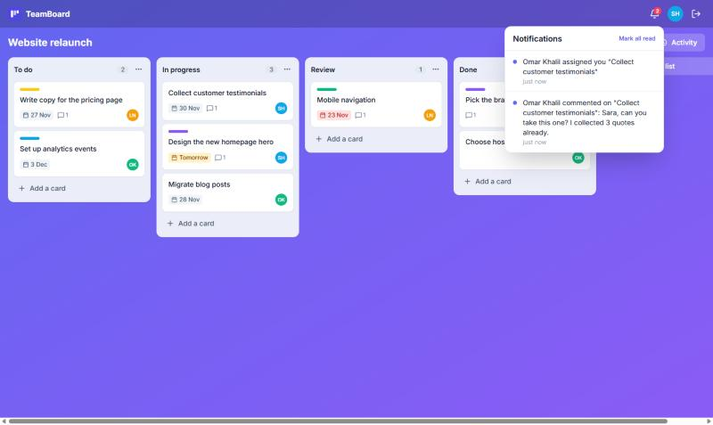
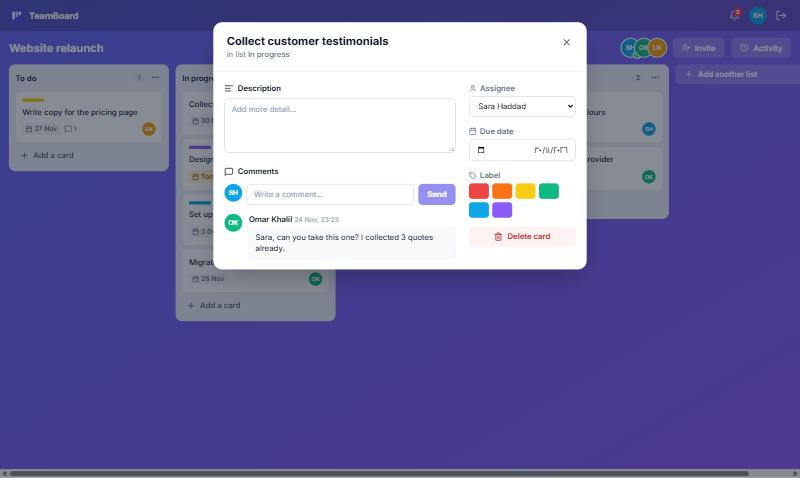
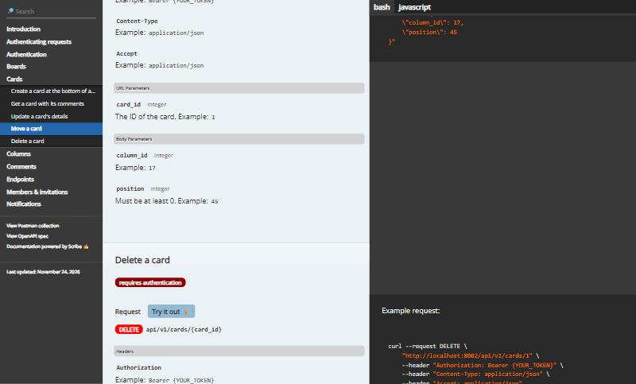

<div align="center">

# TeamBoard

**Real-time task boards for small teams: a Laravel REST API plus a separate Vue 3 SPA.**

[](https://github.com/deema-khaled/teamboard/actions/workflows/ci.yml)




</div>

## What it does

Teams create boards with lists and cards, drag cards between lists, assign them, set due dates and labels, and comment. **Every change appears instantly for everyone on the board**, and you can see who else is looking at it right now. Owners invite teammates by email, and people get live notifications when they're assigned or someone comments.

| A teammate moved a card: it updates live | Live notifications |
| --- | --- |
|  |  |

| Card details | Auto-generated API docs |
| --- | --- |
|  |  |

## Architecture

```
┌────────────────────┐   REST + Bearer token   ┌──────────────────────────┐
│  web/  Vue 3 SPA    │ ──────────────────────► │  api/  Laravel 12 API     │
│  Router · Pinia     │                         │  Sanctum · Policies       │
│  vuedraggable       │ ◄──── WebSockets ────── │  Reverb (presence chans)  │
└────────────────────┘                         │  Queue · Scheduler · Mail │
                                               └──────────┬───────────────┘
                                                PostgreSQL · Redis · Mailpit
```

- **Two independent apps.** The SPA talks to the API only over HTTP/JSON with a Sanctum token, so a mobile app could use the same API.
- **One broadcast event per board** (`board.changed`, with a `type` such as `card.moved`) on a **presence channel**. The SPA patches its Pinia state, and the same channel lists who's online.
- **`toOthers()`.** The SPA sends its socket id with every request, so you don't receive your own changes back.
- **Optimistic UI.** Dragging moves the card immediately; the server's authoritative order comes back and is applied. If the request fails, the board reloads.

## Engineering highlights

- **Consistent ordering under concurrency.** `CardMover` keeps positions as a dense `0..n` sequence per column and rewrites them inside a transaction with row locks, so two people dragging at once can't create gaps or duplicates.
- **Secure invitations.** Only a SHA-256 hash of the token is stored. Invitations are single-use, expire after 7 days, and work only for the invited email.
- **Authorization everywhere.** A `BoardPolicy` (member vs. owner) covers every endpoint, and channel authorization in `routes/channels.php` decides who may join a board's presence channel. Assignees must be board members.
- **Background work.** Invitation emails and notifications are queued. A scheduled command sends "due tomorrow" reminders once per card.
- **Rate limits** on login/register (per email + IP) and on the API (per user).
- **Activity log** per board ("Omar moved X from To do to Review").
- **API documentation** generated by Scribe: [`api/public/docs`](api/public/docs/index.html), plus an OpenAPI spec and a Postman collection.

## Tech stack

| | |
| --- | --- |
| API | Laravel 12, Sanctum (tokens), Reverb (WebSockets), queues, scheduler, notifications, Scribe |
| SPA | Vue 3 + TypeScript, Vite, Vue Router, Pinia, Laravel Echo, vuedraggable (SortableJS), Tailwind CSS |
| Data | PostgreSQL 17, Redis 7 |
| Quality | Pest (29 tests), Pint, `vue-tsc` type-checking |
| DevOps | Docker Compose (API, Nginx, queue, scheduler, Reverb, SPA), GitHub Actions (tests on SQLite **and** PostgreSQL + SPA build) |

## API at a glance

```
POST   /api/v1/auth/register | login | logout      GET /api/v1/auth/me
GET    /api/v1/boards                    POST   /api/v1/boards
GET    /api/v1/boards/{board}            PATCH  /api/v1/boards/{board}
POST   /api/v1/boards/{board}/columns    PUT    /api/v1/boards/{board}/columns/order
POST   /api/v1/columns/{column}/cards    PATCH  /api/v1/cards/{card}/move
POST   /api/v1/cards/{card}/comments     POST   /api/v1/boards/{board}/invitations
POST   /api/v1/invitations/{token}/accept
GET    /api/v1/notifications             POST   /api/v1/notifications/read-all
```

## Running it

### Option A: everything in Docker

```bash
git clone https://github.com/deema-khaled/teamboard.git && cd teamboard
cp api/.env.example api/.env
# Generate a key and paste it into APP_KEY in api/.env
docker run --rm php:8.4-cli php -r "echo 'base64:'.base64_encode(random_bytes(32)).PHP_EOL;"
docker compose --profile app up -d --build
```

| | |
| --- | --- |
| App (SPA) | http://localhost:5180 |
| API docs | http://localhost:8002/docs/ |
| Emails (Mailpit) | http://localhost:8026 |

### Option B: local development

```bash
docker compose up -d                       # PostgreSQL, Redis, Mailpit

cd api
composer install && cp .env.example .env && php artisan key:generate
php artisan migrate --seed
php artisan serve --port=8002              # API
php artisan reverb:start --port=8085       # WebSockets (new terminal)
php artisan queue:work                     # queue (new terminal)

cd ../web
npm install && cp .env.example .env
npm run dev                                # http://localhost:5180
```

### Demo accounts

Password for all: `password`. Open two browsers, log in as Sara in one and Omar in the other, and drag a card.

`sara@teamboard.test` · `omar@teamboard.test` · `lina@teamboard.test`

## Tests

```bash
cd api && php artisan test
```

They cover auth and token revocation, board permissions (member vs. owner), card ordering (reorder, cross-column moves, clamping, deletes), broadcast events, invitations (hashing, expiry, wrong email, single use), notifications (never notifying the actor), and the reminder command.

## License

MIT
